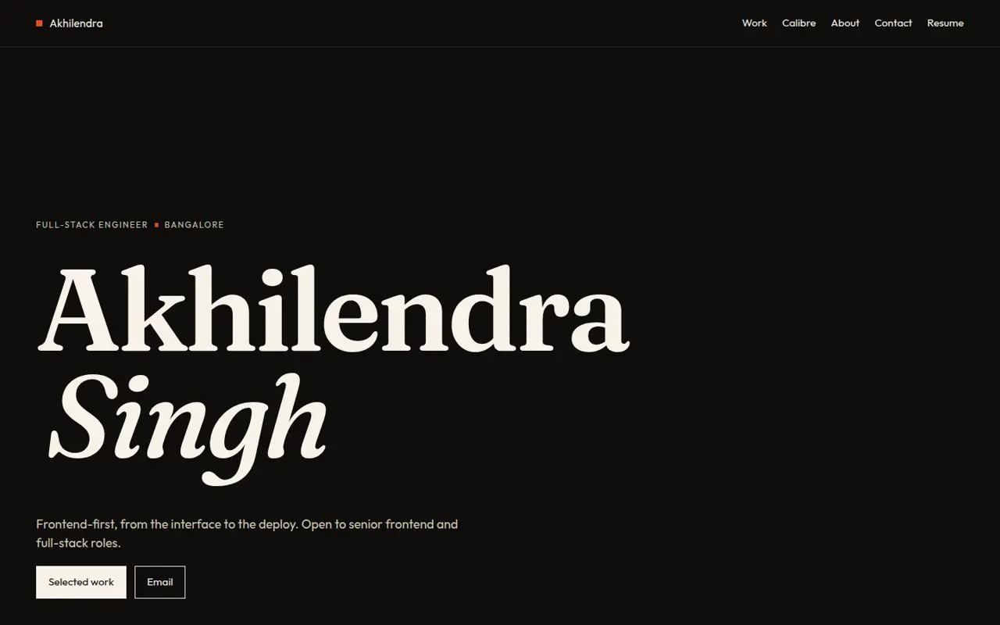
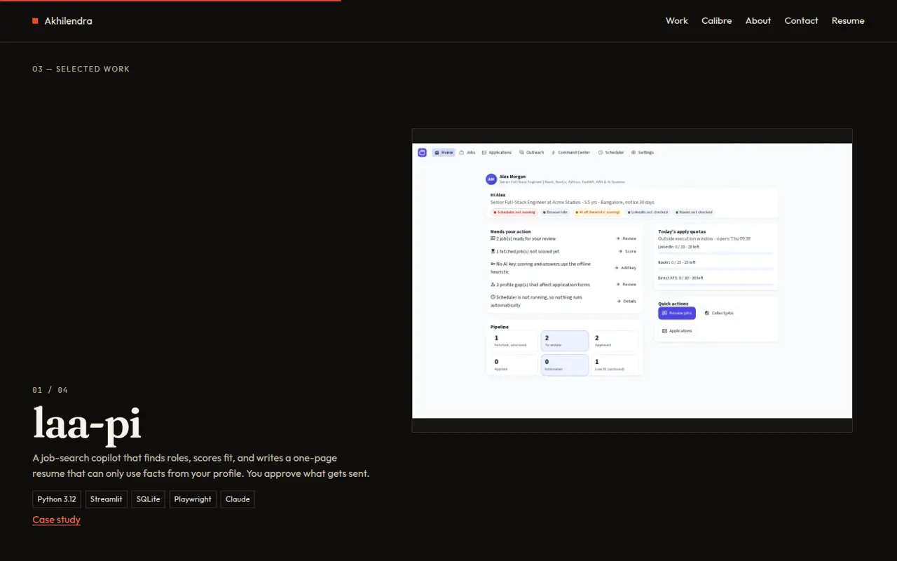
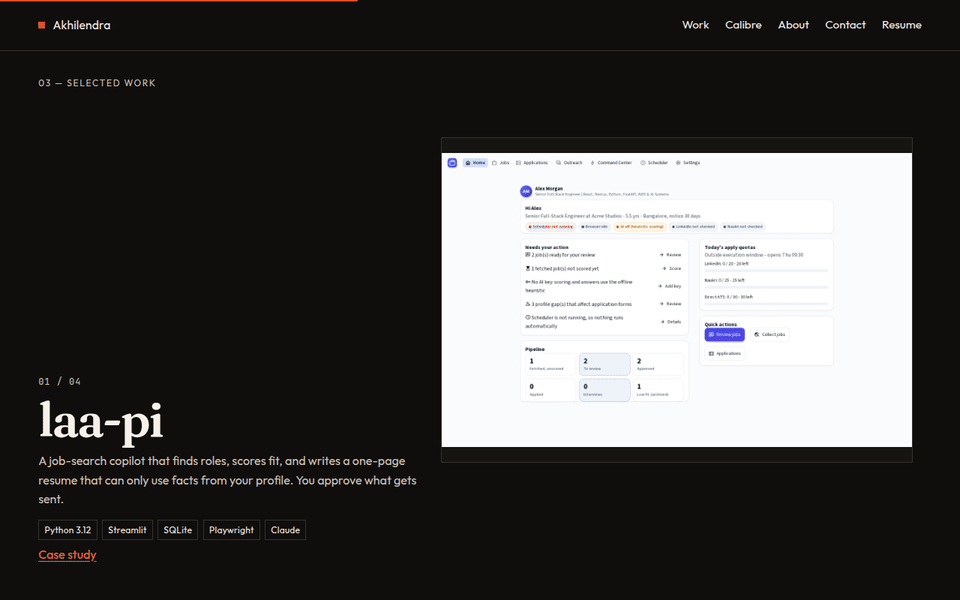
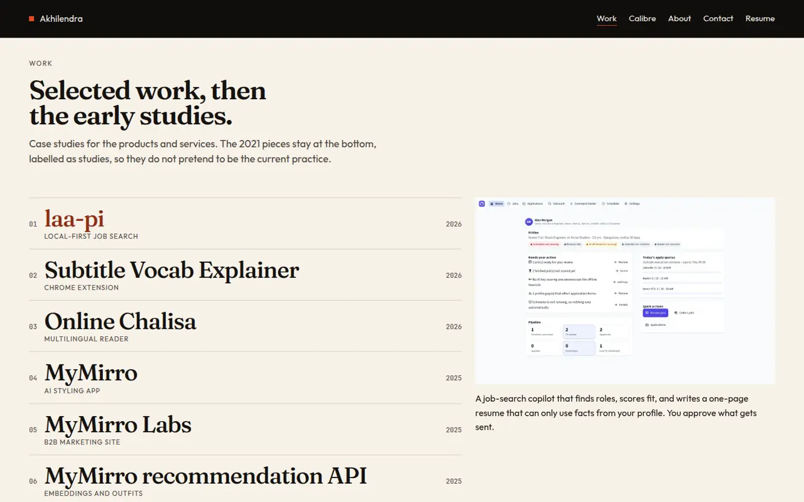
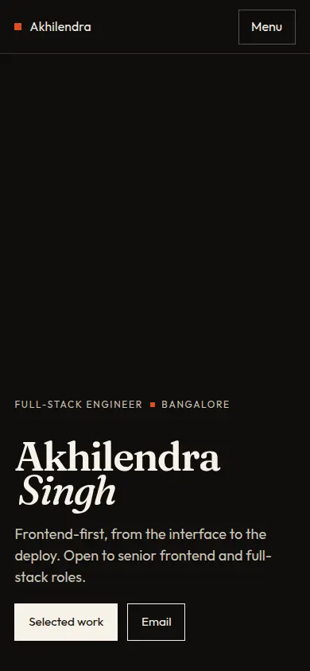
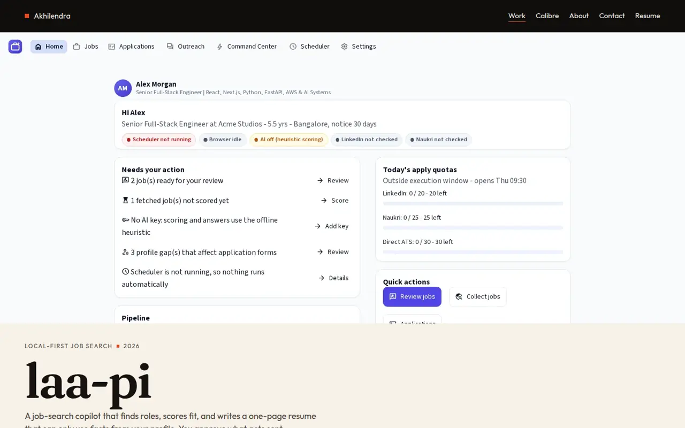
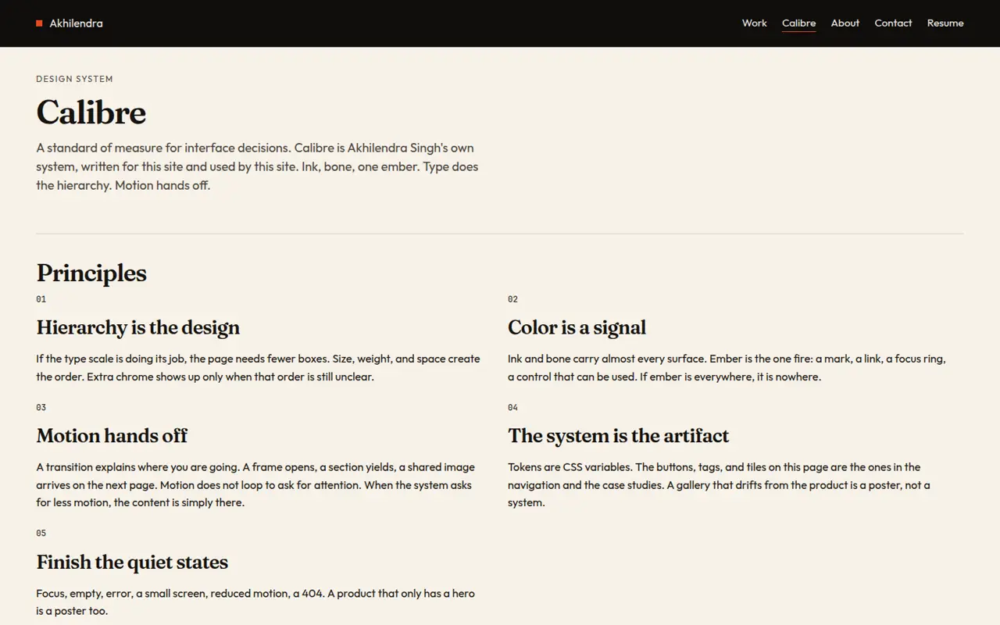
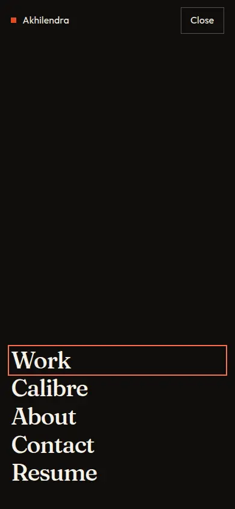

# Akhilendra Singh

Personal site for a full-stack engineer, frontend-first, in Bangalore. The page is the portfolio piece: a scroll-driven case-study film, and **Calibre**, the design system the site is built with.

Live preview, once GitHub Pages is enabled: [akhilsingh2.github.io/portfolio](https://akhilsingh2.github.io/portfolio/). The same build serves at `/` on Vercel.





The reel opens each project in a frame, then scrolls the frame up to fill the stage before the next one settles.



| Desktop | Phone |
| --- | --- |
|  |  |
|  |  |
|  |  |

## Calibre

Calibre is the design system for this site. The name is a standard of measure. It is not a kit from a previous job.

Principles, written out on `/design-system`:

1. **Hierarchy is the design.** Type, weight, and space do the ordering. Boxes are a last resort.
2. **Color is a signal.** Ink and bone carry the page. Ember is the one fire: a mark, a link, a focus ring.
3. **Motion hands off.** A frame opens, a section yields, a shared image arrives on the next page. It does not loop for attention.
4. **The system is the artifact.** Tokens are CSS variables. The gallery uses the same buttons, tags, and tiles as the rest of the site.
5. **Finish the quiet states.** Focus, empty, a small screen, reduced motion, a 404.

Tokens live in [`app/globals.css`](app/globals.css) (`--ink-950`, `--t-7`, `--dur-3`, `--ease-out`, …). The names and roles are listed in [`lib/tokens.ts`](lib/tokens.ts). The design-system page reads the computed values, so a swatch cannot drift from the CSS.

## Stack

- [Next.js 16](https://nextjs.org/) App Router, static export (`output: "export"`)
- A short page fade between routes
- [GSAP](https://gsap.com/) ScrollTrigger for the pinned manifesto and the work reel
- [Lenis](https://github.com/darkroomengineering/lenis) smooth scroll on fine pointers
- Fraunces and Outfit, self-hosted through `next/font`

No client-side data fetching. Content is [`lib/projects.ts`](lib/projects.ts).

## Architecture

```
app/                routes: home, work, work/[slug], design-system, about, resume, 404
app/globals.css     Calibre tokens and components
app/opengraph-image.tsx
components/         header, reel, manifesto, work index, motion demo
lib/projects.ts     case studies
lib/tokens.ts       token catalogue for the specimen page
lib/site.ts         canonical URL and base path
lib/assets.ts       optional portrait and resume, detected at build time
public/work/        project screenshots
.github/workflows/pages.yml
```

`NEXT_PUBLIC_BASE_PATH` is empty by default, so Vercel and local dev serve at `/`. The Pages workflow sets it to `/portfolio`. Links, fonts, images, the canonical URL, the sitemap, and Open Graph all follow that value.

Desktop, with motion allowed, pins two sequences: the three-line practice statement, then the selected-work reel. The frame grows toward the stage, then the next project settles into it. Without JavaScript, on a phone, or with `prefers-reduced-motion`, every project is a normal stacked section. Copy stays in the DOM either way.

Route changes use a CSS fade rather than the View Transitions API. ScrollTrigger's pin wraps the section, and React's view-transition unmount crashed on that wrapper (`removeChild` of a node that was no longer a child). The fade does not touch that tree.

## Performance

Measured with Lighthouse 12, headless Chrome, against the static export of the home page:

| Performance | Accessibility | Best practices | SEO |
| --- | --- | --- | --- |
| 100 | 100 | 100 | 100 |

LCP 1.1s, total blocking time 30ms, cumulative layout shift 0. The home page ships two latin font families, small WebP screenshots, and no image optimizer (static export). GSAP and Lenis load on the client and only run when a fine pointer is present and reduced motion is off.

## Local

```bash
npm install
npm run dev      # http://localhost:3000
npm run build    # writes ./out
npm run lint
npm run typecheck
```

## Deploy

### GitHub Pages

[`.github/workflows/pages.yml`](.github/workflows/pages.yml) builds with `NEXT_PUBLIC_BASE_PATH=/portfolio` and deploys on every push to `main`.

One-time setup: **Settings → Pages → Build and deployment → Source: GitHub Actions.** The site is then [https://akhilsingh2.github.io/portfolio/](https://akhilsingh2.github.io/portfolio/).

### Vercel

1. Import this repository. Framework preset: Next.js. The `output: "export"` config is picked up automatically.
2. Leave `NEXT_PUBLIC_BASE_PATH` unset.
3. Set `NEXT_PUBLIC_SITE_URL` to the production origin, for example `https://akhilendra.dev`.
4. Deploy.

### A custom domain

**On Vercel (simplest).** Add the domain in the project settings and point DNS as Vercel instructs (usually an `A` record to `76.76.21.21` for the apex, or a `CNAME` to `cname.vercel-dns.com` for `www`). Set `NEXT_PUBLIC_SITE_URL` to that origin and redeploy so canonicals and Open Graph match.

**On GitHub Pages.** A custom domain on a project site is served at the domain root, not under `/portfolio`. In the workflow, set `NEXT_PUBLIC_BASE_PATH` to an empty string and `NEXT_PUBLIC_SITE_URL` to `https://your-domain`. Add the domain under Settings → Pages, and add the DNS records GitHub shows (apex `A` records to GitHub's Pages IPs, or a `CNAME` for a subdomain).

## Before the first send

These are left blank on purpose. Drop the files in and rebuild. The pages already look for them.

| What | Where |
| --- | --- |
| Portrait | `public/portrait.webp`, `.jpg`, `.jpeg`, or `.png`. A vertical crop, about 4:5. |
| Resume PDF | `public/Akhilendra-Singh-resume.pdf` |
| One personal line | The "Personal line" slot on the About page, in [`app/about/page.tsx`](app/about/page.tsx) |

Until those exist, the About page shows a monogram, the Resume page says the PDF is not up yet, and neither pretends otherwise.

Two things worth doing in the other repos before a recruiter clicks through:

- `Todo-app` still has a committed SQLite file and a hardcoded JWT secret. Clean that history, or drop the link from [`lib/projects.ts`](lib/projects.ts).
- MyMirro screenshots are a team product. Confirm they are fine to show in public.
